# Gates — Cadence Virtuoso

Biblioteca de portas lógicas CMOS projetadas no **Cadence Virtuoso** (IC23.1) com o PDK **GPDK045** (45 nm) e simuladas com o **Spectre** via **ADE Maestro**.
Este repositório é a versão em *layout de circuito/esquemático* do projeto [`gates`](https://github.com/Emerson-Nunes/gates) (que descreve as mesmas portas em Verilog/SystemVerilog): aqui cada porta é desenhada em nível de **transistor**.

## Sumário

- [Visão geral](#visão-geral)
- [Estrutura do repositório](#estrutura-do-repositório)
- [Parâmetros de projeto e simulação](#parâmetros-de-projeto-e-simulação)
- [Resumo das portas](#resumo-das-portas)
- [Detalhe de cada porta](#detalhe-de-cada-porta)
  - [Inversor (NOT)](#inverter)
  - [Testbench do Inversor](#teste_inverter)
  - [NAND de 2 entradas](#nand_2)
  - [NAND de 3 entradas](#nand_3)
  - [AND de 3 entradas](#and_3)
  - [NOR de 3 entradas](#nor_3)
  - [OR de 3 entradas](#or_3)
  - [XOR de 2 entradas](#xor_2)
  - [XOR de 3 entradas (paridade ímpar)](#xor_3)
  - [XNOR de 3 entradas (paridade par)](#xnor_3)
  - [Multiplexador 4:1](#mult_4_1)
- [Como abrir o projeto no Virtuoso](#como-abrir-o-projeto-no-virtuoso)
- [Como executar uma simulação](#como-executar-uma-simulação)
- [Como as imagens foram obtidas](#como-as-imagens-foram-obtidas)

## Visão geral

| Item | Valor |
|---|---|
| Ferramenta de projeto | Cadence Virtuoso IC23.1 |
| Simulador | Spectre 23.1 (análise transiente, `tran`) |
| Ambiente de simulação | ADE Maestro (view `maestro`) |
| PDK | GPDK045 — transistores `g45n1svt` (NMOS) e `g45p1svt` (PMOS) |
| Biblioteca | `gates_Emerson` |
| Views por célula | `schematic`, `maestro` e (em `inverter` e `nand_2`) `symbol` |
| Alimentação | VDD = 1 V |
| Temperatura | 27 °C |
| Dimensões dos transistores | W = 120 nm, L = 45 nm, `nf = 1` (todos iguais) |

Todas as portas são **CMOS estático complementar**: uma rede *pull-up* de PMOS ligada ao VDD e uma rede *pull-down* de NMOS ligada ao GND, que nunca conduzem ao mesmo tempo em regime estático. As portas compostas (AND, OR, XOR, XNOR) reutilizam o sub-circuito `inverter`.

## Estrutura do repositório

```
gates_Virtuoso/
├── README.md
├── docs/img/                  # imagens usadas neste README
└── gates_Emerson/             # biblioteca do Virtuoso (copiar como está)
    ├── cdsinfo.tag, data.dm, .oalib
    ├── inverter/    (schematic, symbol, maestro)
    ├── teste_inverter/ (schematic, maestro)
    ├── nand_2/      (schematic, symbol, maestro)
    ├── nand_3/      (schematic, maestro)
    ├── and_3/       (schematic, maestro)
    ├── nor_3/       (schematic, maestro)
    ├── or_3/        (schematic, maestro)
    ├── xor_2/       (schematic, maestro)
    ├── xor_3/       (schematic, maestro)
    ├── xnor_3/      (schematic, maestro)
    └── mult_4_1/    (schematic, maestro)    # multiplexador 4:1
```

Em cada célula:

| Pasta | Conteúdo |
|---|---|
| `schematic/` | `sch.oa` — esquemático em OpenAccess; `thumbnail_128x128.png` — miniatura |
| `symbol/` | `symbol.oa` — símbolo para uso hierárquico (só `inverter` e `nand_2`) |
| `maestro/` | `maestro.sdb`, `active.state` — configuração do ADE Maestro; `namedStimuli/stimuli.xml` — fontes de pulso; `results/` e `history/` — resultados da última simulação |

## Parâmetros de projeto e simulação

- **Estímulos:** fontes `vpulse` com rise/fall = 1 ps e atraso = 1 ps. Nas portas de 2 e 3 entradas os períodos são potências de 2 (`pA=8n`, `pB=4n`, `pC=2n`), o que faz as entradas **contarem em binário** e cobrirem **toda a tabela-verdade em uma única simulação**, com cada combinação durando 1 ns (2 ns nas de 2 entradas).
- **Parâmetros de projeto Maestro:** `vdd=1`, `pA`, `pB`, `pC` (e `pD`, `pS1`, `pS0` no MUX) são variáveis globais do Maestro, o que permite alterar a velocidade dos estímulos sem editar o esquemático.
- **Análise:** `tran` com `stop` igual ao período da entrada mais lenta.

## Resumo das portas

| Célula | Função | Transistores | Simulação (tran) |
|---|---|:---:|:---:|
| [`inverter`](#inverter) | Y = ¬A | 2 | 2 ns |
| [`teste_inverter`](#teste_inverter) | teste do inversor | 2 | 2 ns |
| [`nand_2`](#nand_2) | Y = ¬(A·B) | 4 | 8 ns |
| [`nand_3`](#nand_3) | Y = ¬(A·B·C) | 6 | 8 ns |
| [`and_3`](#and_3) | Y = A·B·C | 8 | 8 ns |
| [`nor_3`](#nor_3) | Y = ¬(A+B+C) | 6 | 8 ns |
| [`or_3`](#or_3) | Y = A+B+C | 8 | 8 ns |
| [`xor_2`](#xor_2) | Y = A⊕B | 14 | 8 ns |
| [`xor_3`](#xor_3) | Y = A⊕B⊕C | 32 | 8 ns |
| [`xnor_3`](#xnor_3) | Y = ¬(A⊕B⊕C) | 30 | 8 ns |
| [`mult_4_1`](#mult_4_1) | MUX 4:1 | 30 | 64 ns |

## Detalhe de cada porta

Para cada porta há: miniatura do esquemático (e do símbolo, quando existe), descrição da topologia, estímulos, tabela-verdade, **diagrama de tempo** e a **captura da forma de onda** gerada pelo próprio Virtuoso/ViVA.

> **Sobre as figuras:** `miniatura` = `thumbnail_128x128.png` salvo pelo Virtuoso; `captura ViVA` = PNG exportado da janela de formas de onda do Maestro; `diagrama de tempo` = gráfico gerado a partir do netlist do Spectre (a função lógica de cada porta foi calculada a nível de chaves sobre o netlist e conferida com a tabela-verdade esperada).

### Inversor (NOT)
<a id="inverter"></a>

**Célula:** `gates_Emerson/inverter`  
**Transistores:** 2 (1 PMOS + 1 NMOS)

Bloco fundamental do projeto: é reaproveitado como sub-circuito (`inverter`) nas portas AND, OR, XOR, XNOR e no MUX.

<table><tr><td align="center">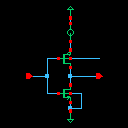<br><sub>Esquemático (miniatura)</sub></td><td align="center">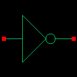<br><sub>Símbolo (miniatura)</sub></td></tr></table>

**Topologia.** `PM0` liga `out` ao VDD quando `in = 0`; `NM0` liga `out` ao GND quando `in = 1`. Os dois transistores compartilham a mesma entrada e a mesma saída, formando o inversor CMOS clássico.

**Estímulo e simulação.** Fonte `pulse` em `in`: 0 V → 1 V, período 2 ns, largura 1 ns, rise/fall 1 ps. Transiente de **0 a 2 ns**.

**Tabela-verdade** — `Y = ¬A`

| in | **out** |
|---|---|
| 0 | **1** |
| 1 | **0** |

**Diagrama de tempo**

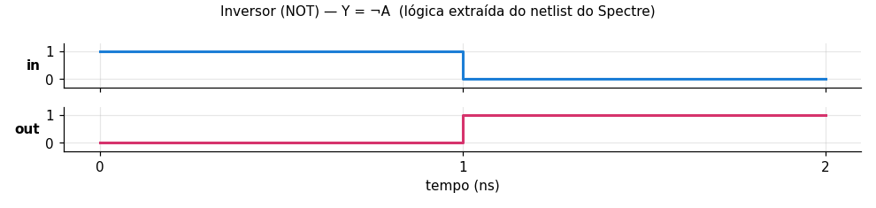

**Captura da forma de onda no Virtuoso (ViVA)**

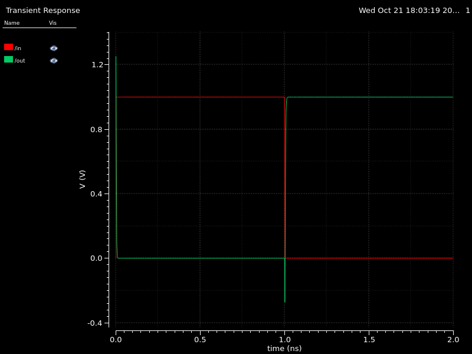

[↑ voltar ao sumário](#sumário)

---

### Testbench do Inversor
<a id="teste_inverter"></a>

**Célula:** `gates_Emerson/teste_inverter`  
**Transistores:** 2 (instância do `inverter`)

Célula de teste que instancia o símbolo do inversor (`I0`) para verificar o sub-circuito como um bloco hierárquico.

<table><tr><td align="center">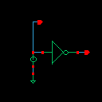<br><sub>Esquemático (miniatura)</sub></td></tr></table>

**Topologia.** Instância `I0 (teste out) inverter` com a entrada `teste` ligada a uma fonte DC de 0 V; com entrada em `0` a saída `out` vai para `1` (VDD).

**Estímulo e simulação.** Fonte DC `V0` = 0 V em `teste`. Transiente de **0 a 2 ns** (verificação de ponto de operação/estado estável).

**Resultado esperado:** entrada `teste = 0` → saída `out = 1`; é o caso de `A=0` da tabela-verdade do inversor.

**Captura da forma de onda no Virtuoso (ViVA)**

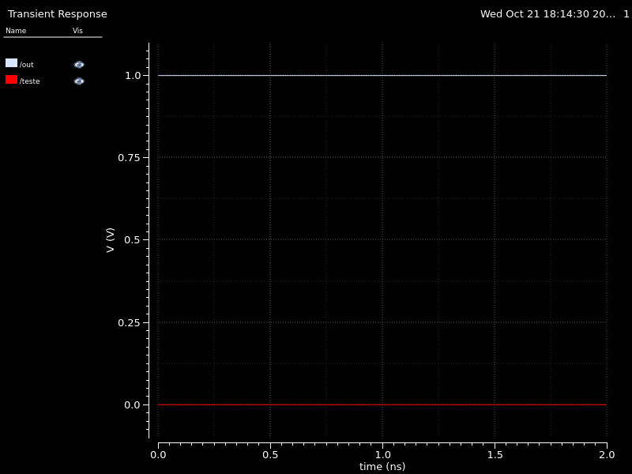

[↑ voltar ao sumário](#sumário)

---

### NAND de 2 entradas
<a id="nand_2"></a>

**Célula:** `gates_Emerson/nand_2`  
**Transistores:** 4 (2 PMOS + 2 NMOS)

Porta NAND em lógica CMOS estática.

<table><tr><td align="center">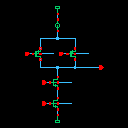<br><sub>Esquemático (miniatura)</sub></td><td align="center">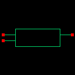<br><sub>Símbolo (miniatura)</sub></td></tr></table>

**Topologia.** **Pull-up:** `PM0` (A) e `PM1` (B) em **paralelo** entre VDD e `Y`. **Pull-down:** `NM0` (A) e `NM1` (B) em **série** entre `Y` e GND (nó intermediário `net1`). A saída só vai a 0 quando A **e** B estão em 1.

**Estímulo e simulação.** `A`: pulse 0→1, período 8 ns, largura 4 ns. `B`: pulse 0→1, período 4 ns, largura 2 ns. Percorre as 4 combinações de entrada em **0 a 8 ns**.

**Tabela-verdade** — `Y = ¬(A·B)`

| A | B | **Y** |
|---|---|---|
| 0 | 0 | **1** |
| 0 | 1 | **1** |
| 1 | 0 | **1** |
| 1 | 1 | **0** |

**Diagrama de tempo**

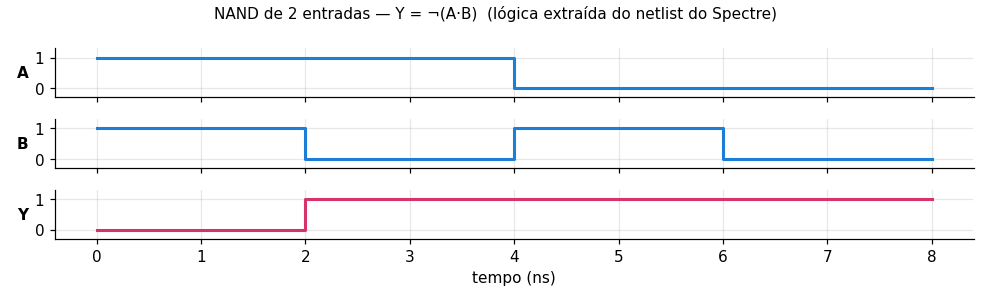

**Captura da forma de onda no Virtuoso (ViVA)**

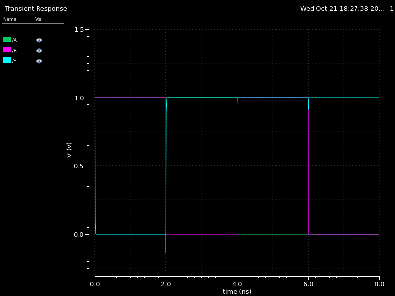

[↑ voltar ao sumário](#sumário)

---

### NAND de 3 entradas
<a id="nand_3"></a>

**Célula:** `gates_Emerson/nand_3`  
**Transistores:** 6 (3 PMOS + 3 NMOS)

Extensão da NAND para 3 entradas.

<table><tr><td align="center">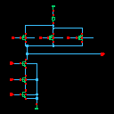<br><sub>Esquemático (miniatura)</sub></td></tr></table>

**Topologia.** **Pull-up:** `PM0`, `PM1`, `PM2` em **paralelo** (A, B, C). **Pull-down:** `NM0`, `NM1`, `NM2` em **série** (nós `net13` e `net17`). Só conduz para GND com A=B=C=1.

**Estímulo e simulação.** Parâmetros `pA=8`, `pB=4`, `pC=2` (× 1 ns). Pulsos com `val0=1`, `val1=0`, largura = período/2, de modo que as entradas **contam em binário de 000 a 111, a cada 1 ns**. Transiente de **0 a 8 ns**.

**Tabela-verdade** — `Y = ¬(A·B·C)`

| A | B | C | **Y** |
|---|---|---|---|
| 0 | 0 | 0 | **1** |
| 0 | 0 | 1 | **1** |
| 0 | 1 | 0 | **1** |
| 0 | 1 | 1 | **1** |
| 1 | 0 | 0 | **1** |
| 1 | 0 | 1 | **1** |
| 1 | 1 | 0 | **1** |
| 1 | 1 | 1 | **0** |

**Diagrama de tempo**

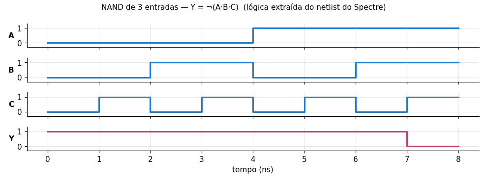

**Captura da forma de onda no Virtuoso (ViVA)**

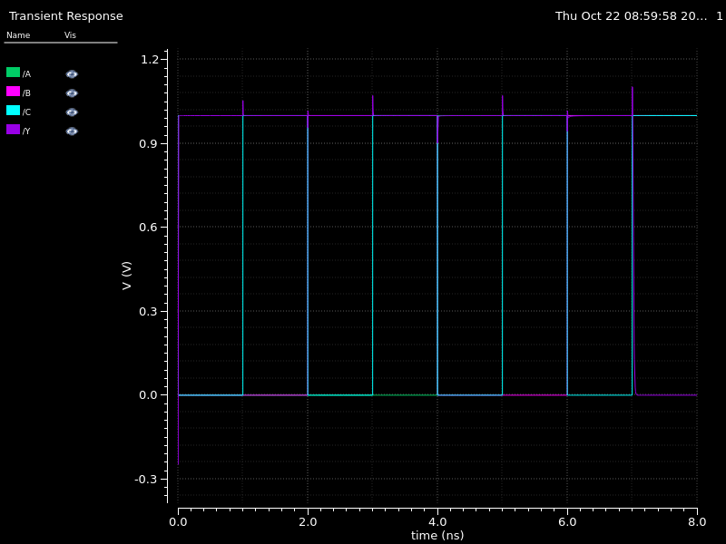

[↑ voltar ao sumário](#sumário)

---

### AND de 3 entradas
<a id="and_3"></a>

**Célula:** `gates_Emerson/and_3`  
**Transistores:** 8 (NAND3 de 6 + inversor de 2)

AND construída como NAND de 3 entradas seguida de um inversor (a AND CMOS não existe em um único estágio).

<table><tr><td align="center">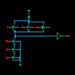<br><sub>Esquemático (miniatura)</sub></td></tr></table>

**Topologia.** Primeiro estágio idêntico ao `nand_3` gerando `net1`; o inversor `I2 (net1 Y)` restaura a polaridade, resultando em `Y = A·B·C`. Também mantém o `nand_3` na pasta de resultados como sub-teste (`gates_Emerson_nand_3_1`).

**Estímulo e simulação.** `pA=8n`, `pB=4n`, `pC=2n`; contagem binária 000→111 a cada 1 ns. Transiente de **0 a 8 ns** (`stop=pA`).

**Tabela-verdade** — `Y = A·B·C`

| A | B | C | **Y** |
|---|---|---|---|
| 0 | 0 | 0 | **0** |
| 0 | 0 | 1 | **0** |
| 0 | 1 | 0 | **0** |
| 0 | 1 | 1 | **0** |
| 1 | 0 | 0 | **0** |
| 1 | 0 | 1 | **0** |
| 1 | 1 | 0 | **0** |
| 1 | 1 | 1 | **1** |

**Diagrama de tempo**

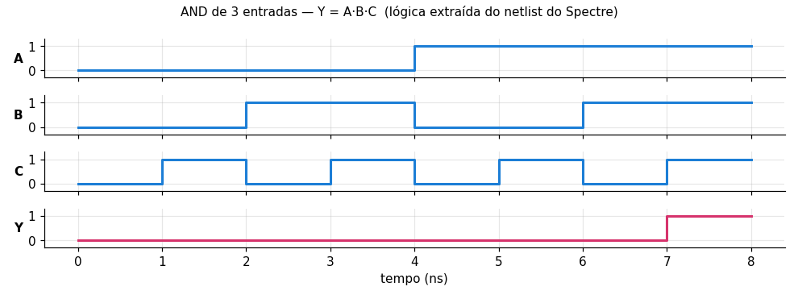

**Captura da forma de onda no Virtuoso (ViVA)**

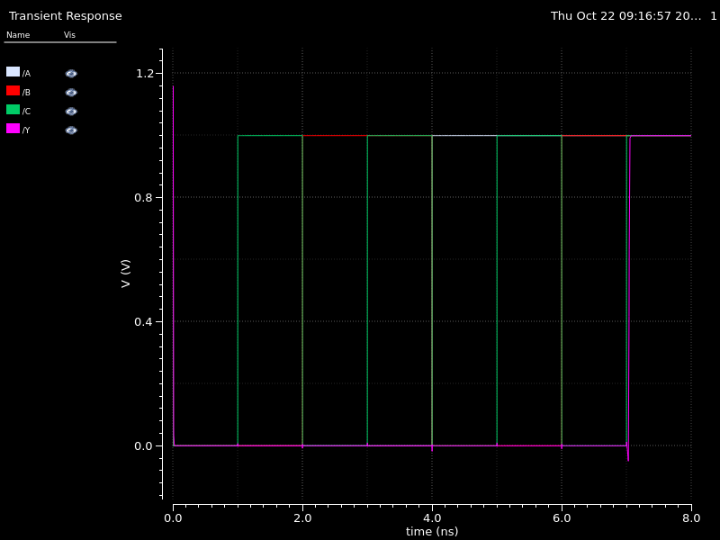

[↑ voltar ao sumário](#sumário)

---

### NOR de 3 entradas
<a id="nor_3"></a>

**Célula:** `gates_Emerson/nor_3`  
**Transistores:** 6 (3 PMOS + 3 NMOS)

Porta NOR de 3 entradas em CMOS estático.

<table><tr><td align="center">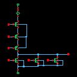<br><sub>Esquemático (miniatura)</sub></td></tr></table>

**Topologia.** **Pull-up:** `PM0`, `PM1`, `PM2` em **série** (A, B, C; nós `net4` e `net8`) a partir da alimentação `net1` (fonte `V0 = vdd`). **Pull-down:** `NM0`, `NM1`, `NM2` em **paralelo**. A saída só é 1 com A=B=C=0.

**Estímulo e simulação.** `pA=8n`, `pB=4n`, `pC=2n`, `vdd=1`; contagem binária 000→111 a cada 1 ns. Transiente de **0 a 8 ns**.

**Tabela-verdade** — `Y = ¬(A+B+C)`

| A | B | C | **Y** |
|---|---|---|---|
| 0 | 0 | 0 | **1** |
| 0 | 0 | 1 | **0** |
| 0 | 1 | 0 | **0** |
| 0 | 1 | 1 | **0** |
| 1 | 0 | 0 | **0** |
| 1 | 0 | 1 | **0** |
| 1 | 1 | 0 | **0** |
| 1 | 1 | 1 | **0** |

**Diagrama de tempo**

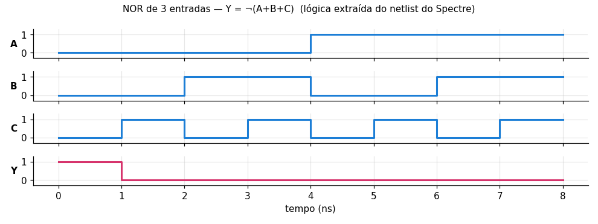

**Captura da forma de onda no Virtuoso (ViVA)**

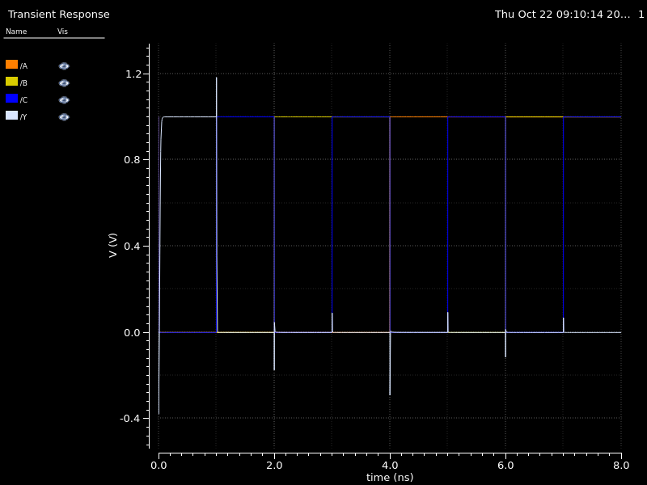

[↑ voltar ao sumário](#sumário)

---

### OR de 3 entradas
<a id="or_3"></a>

**Célula:** `gates_Emerson/or_3`  
**Transistores:** 8 (NOR3 de 6 + inversor de 2)

OR construída como NOR de 3 entradas seguida de inversor.

<table><tr><td align="center">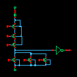<br><sub>Esquemático (miniatura)</sub></td></tr></table>

**Topologia.** Estágio NOR3 (3 PMOS em série, 3 NMOS em paralelo) gera `net12`; o inversor `I3 (net12 Y)` produz `Y = A+B+C`.

**Estímulo e simulação.** `pA=8n`, `pB=4n`, `pC=2n`; contagem binária 000→111 a cada 1 ns. Transiente de **0 a 8 ns**.

**Tabela-verdade** — `Y = A+B+C`

| A | B | C | **Y** |
|---|---|---|---|
| 0 | 0 | 0 | **0** |
| 0 | 0 | 1 | **1** |
| 0 | 1 | 0 | **1** |
| 0 | 1 | 1 | **1** |
| 1 | 0 | 0 | **1** |
| 1 | 0 | 1 | **1** |
| 1 | 1 | 0 | **1** |
| 1 | 1 | 1 | **1** |

**Diagrama de tempo**

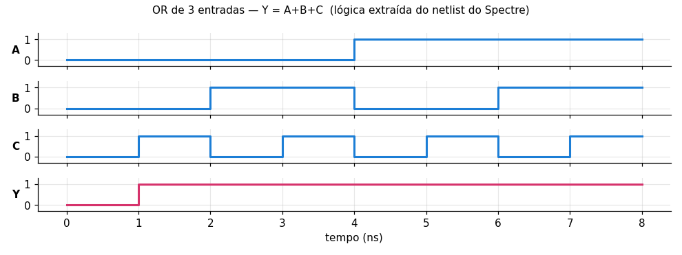

**Captura da forma de onda no Virtuoso (ViVA)**

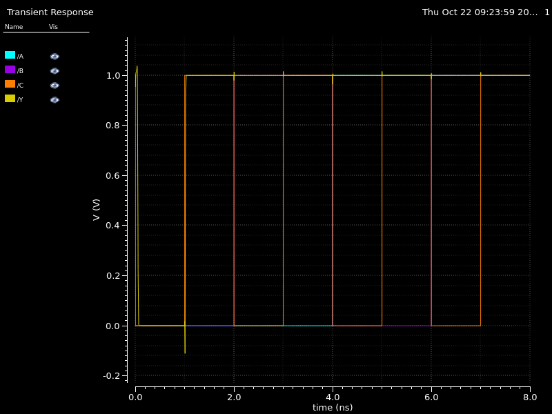

[↑ voltar ao sumário](#sumário)

---

### XOR de 2 entradas
<a id="xor_2"></a>

**Célula:** `gates_Emerson/xor_2`  
**Transistores:** 14 (8 no núcleo + 3 inversores de 2)

XOR de 2 entradas implementada com os complementos das entradas (`-A`, `-B`) e inversor na saída.

<table><tr><td align="center">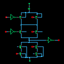<br><sub>Esquemático (miniatura)</sub></td></tr></table>

**Topologia.** Inversores `I2` e `I3` geram `-A` e `-B`. O núcleo (4 PMOS + 4 NMOS) forma uma porta complexa (AOI/OAI) cujo nó `net12` é invertido por `I4` para gerar `Y = A⊕B`.

**Estímulo e simulação.** `pA=8n`, `pB=4n`; `A` e `B` percorrem 00→01→10→11 (2 ns cada). Transiente de **0 a 8 ns**.

**Tabela-verdade** — `Y = A⊕B`

| A | B | **Y** |
|---|---|---|
| 0 | 0 | **0** |
| 0 | 1 | **1** |
| 1 | 0 | **1** |
| 1 | 1 | **0** |

**Diagrama de tempo**

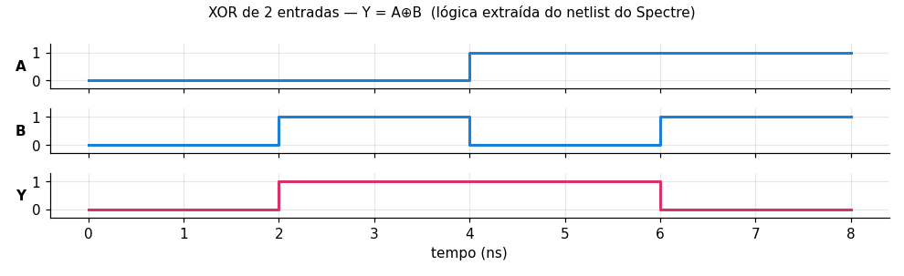

[↑ voltar ao sumário](#sumário)

---

### XOR de 3 entradas (paridade ímpar)
<a id="xor_3"></a>

**Célula:** `gates_Emerson/xor_3`  
**Transistores:** 32 (24 no núcleo + 4 inversores de 2)

XOR de 3 entradas: `Y = 1` quando o número de entradas em 1 é ímpar.

<table><tr><td align="center">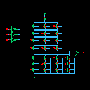<br><sub>Esquemático (miniatura)</sub></td></tr></table>

**Topologia.** Inversores `I2`, `I3`, `I4` geram `-A`, `-B`, `-C`. O núcleo de 24 transistores (12 PMOS + 12 NMOS) implementa a função complexa em `net41`, e `I5 (net41 Y)` inverte para a saída.

**Estímulo e simulação.** `pA=8n`, `pB=4n`, `pC=2n`; contagem binária 000→111 a cada 1 ns. Transiente de **0 a 8 ns**.

**Tabela-verdade** — `Y = A⊕B⊕C`

| A | B | C | **Y** |
|---|---|---|---|
| 0 | 0 | 0 | **0** |
| 0 | 0 | 1 | **1** |
| 0 | 1 | 0 | **1** |
| 0 | 1 | 1 | **0** |
| 1 | 0 | 0 | **1** |
| 1 | 0 | 1 | **0** |
| 1 | 1 | 0 | **0** |
| 1 | 1 | 1 | **1** |

**Diagrama de tempo**

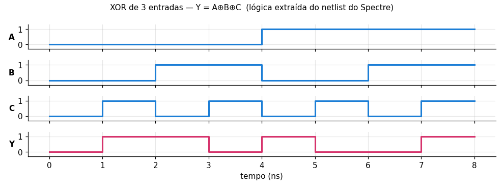

**Captura da forma de onda no Virtuoso (ViVA)**

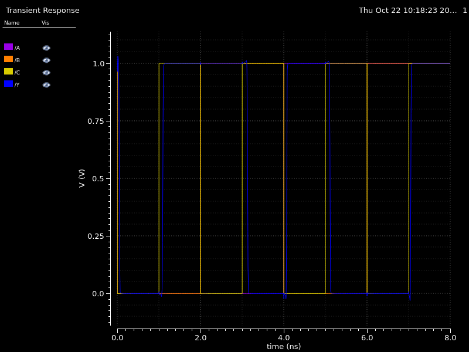

[↑ voltar ao sumário](#sumário)

---

### XNOR de 3 entradas (paridade par)
<a id="xnor_3"></a>

**Célula:** `gates_Emerson/xnor_3`  
**Transistores:** 30 (24 no núcleo + 3 inversores de 2)

Complemento da XOR3: `Y = 1` quando o número de entradas em 1 é par.

<table><tr><td align="center">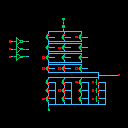<br><sub>Esquemático (miniatura)</sub></td></tr></table>

**Topologia.** Mesma estrutura do `xor_3` (inversores de entrada `I2`–`I4` e núcleo de 24 transistores), mas com a saída `Y` tirada diretamente do núcleo, sem o inversor final.

**Estímulo e simulação.** `pA=8n`, `pB=4n`, `pC=2n`; contagem binária 000→111 a cada 1 ns. Transiente de **0 a 8 ns**.

**Tabela-verdade** — `Y = ¬(A⊕B⊕C)`

| A | B | C | **Y** |
|---|---|---|---|
| 0 | 0 | 0 | **1** |
| 0 | 0 | 1 | **0** |
| 0 | 1 | 0 | **0** |
| 0 | 1 | 1 | **1** |
| 1 | 0 | 0 | **0** |
| 1 | 0 | 1 | **1** |
| 1 | 1 | 0 | **1** |
| 1 | 1 | 1 | **0** |

**Diagrama de tempo**

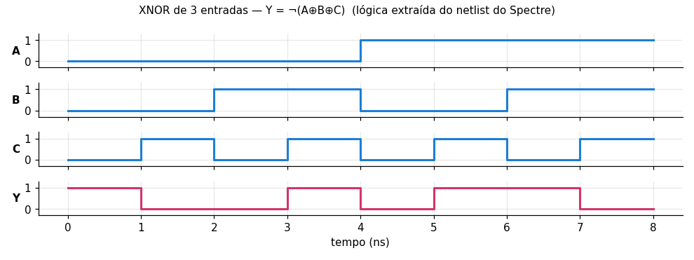

**Captura da forma de onda no Virtuoso (ViVA)**

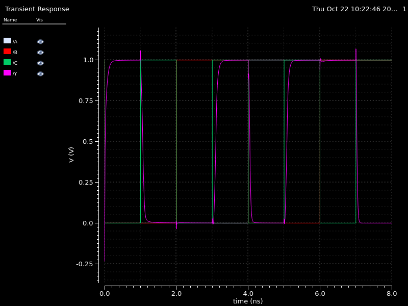

[↑ voltar ao sumário](#sumário)

---

### Multiplexador 4:1
<a id="mult_4_1"></a>

**Célula:** `gates_Emerson/mult_4_1`  
**Transistores:** 30 (24 no núcleo + 3 inversores de 2)

Multiplexador de 4 entradas de dados (`A`, `B`, `C`, `D`) e 2 de seleção (`S1`, `S0`). (A pasta se chama `mult_4_1`, mas o circuito é um **MUX**.)

<table><tr><td align="center">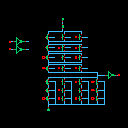<br><sub>Esquemático (miniatura)</sub></td></tr></table>

**Topologia.** Inversores `I2`/`I3` geram `-S0`/`-S1`; o núcleo de 24 transistores seleciona uma das entradas em `net2`, e `I7 (net2 Y)` inverte para a saída. A seleção, verificada no netlist, é a da tabela abaixo.

**Estímulo e simulação.** Seis fontes pulse com períodos `pD=2n`, `pC=4n`, `pB=8n`, `pA=16n`, `pS1=32n`, `pS0=64n`: as 6 entradas contam em binário e percorrem as **64 combinações, 1 ns cada**. Transiente de **0 a 64 ns** (`stop=pS0`).

**Seleção (extraída do netlist):**

| S1 | S0 | Y |
|---|---|---|
| 0 | 0 | A |
| 0 | 1 | C |
| 1 | 0 | B |
| 1 | 1 | D |

> A ordem de seleção não é a convencional (`S0` escolhe entre A↔C e `S1` entre A↔B). Se o desejado for `00→A, 01→B, 10→C, 11→D`, basta trocar as ligações de `B` e `C` no esquemático. Com 6 entradas a tabela completa teria 64 linhas, por isso ela não é listada aqui.

**Diagrama de tempo**

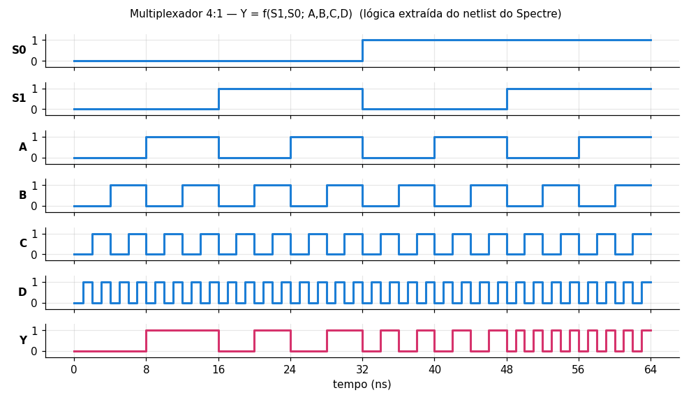

**Captura da forma de onda no Virtuoso (ViVA)**

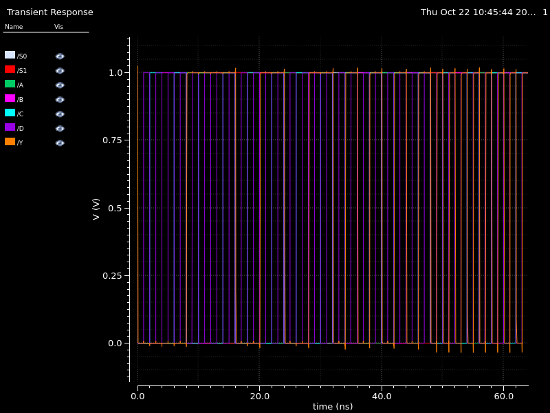

[↑ voltar ao sumário](#sumário)

---

## Como abrir o projeto no Virtuoso

1. Clone o repositório e entre na pasta:
   ```bash
   git clone https://github.com/Emerson-Nunes/gates_Virtuoso.git
   cd gates_Virtuoso
   ```
2. No diretório de trabalho do Virtuoso (onde está o `cds.lib`), registre a biblioteca e garanta que o PDK GPDK045 também está definido:
   ```
   DEFINE gates_Emerson /caminho/para/gates_Virtuoso/gates_Emerson
   INCLUDE /caminho/para/gpdk045/cds.lib      # ajuste para a instalação do PDK
   ```
3. Abra o Virtuoso (`virtuoso &`), vá em **Library Manager**, selecione `gates_Emerson` e abra a view `schematic` da porta desejada.

> As células dependem dos transistores `g45n1svt`/`g45p1svt` do **GPDK045** (e do `analogLib` para `gnd`/`vdd`). Sem o PDK o esquemático abre, mas as instâncias aparecem sem *master*.

## Como executar uma simulação

1. No Library Manager, abra a view **`maestro`** da célula (por exemplo `gates_Emerson/xor_3/maestro`).
2. Confirme em *Setup → Model Libraries* o arquivo de modelos do GPDK045 e o simulador **spectre**.
3. Clique em **Run Single Run, Sweeps and Corners** (▶).
4. Ao terminar, as formas de onda dos sinais de entrada (`A`, `B`, `C`…) e da saída `Y` são plotadas no ViVA.
5. Compare a saída com a tabela-verdade da porta; a saída muda ~ps após cada transição de entrada.

Para testar outras velocidades, altere as variáveis de projeto (`pA`, `pB`, `pC`, `vdd`) no Maestro — sem mexer no esquemático.

> **Observação sobre os resultados:** nas capturas, os picos de ~1,2 V e as pequenas subidas abaixo de 0 V no início e nas transições são **overshoots** devido ao acoplamento capacitivo (*glitch*/*charge injection*) dos transistores durante as transições das entradas; o nível lógico final sempre volta a 0 V ou 1 V.

## Como as imagens foram obtidas

| Tipo | Origem |
|---|---|
| Miniaturas do esquemático/símbolo | `schematic/thumbnail_128x128.png` e `symbol/thumbnail_128x128.png`, gerados automaticamente pelo Virtuoso |
| Capturas ViVA | `maestro/results/.../dsWaveforms/dsImg_window_*.png`, exportadas do visualizador de formas de onda |
| Diagramas de tempo | Gerados com Python/matplotlib a partir do netlist (`input.scs`) de cada simulação |

## Autor

Emerson Nunes — [@Emerson-Nunes](https://github.com/Emerson-Nunes)
